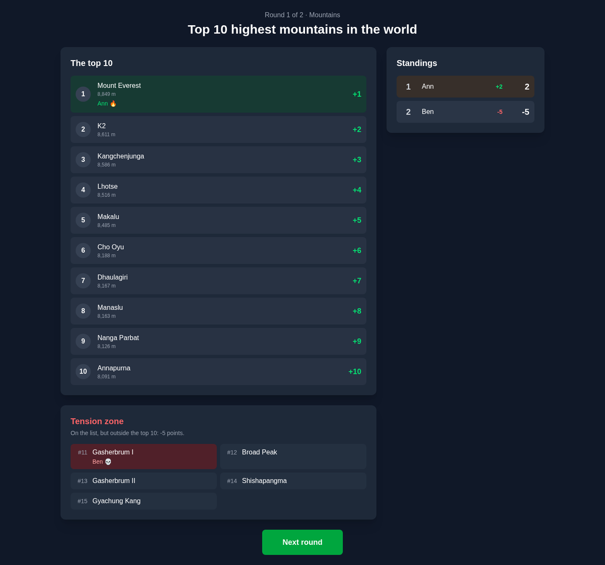
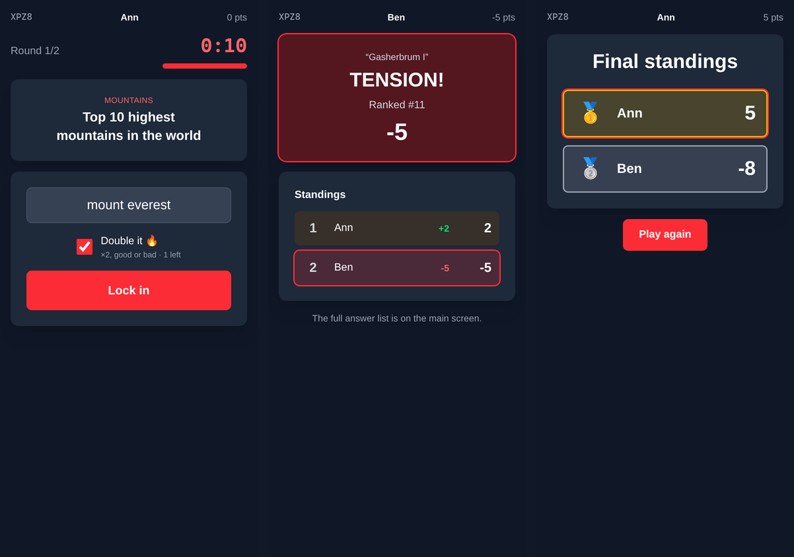

# Tension

A real-time party trivia game inspired by *Tenable*. One screen — a laptop on the TV — shows the
questions, the countdown and the big reveal. Everyone else plays on their phone; no app to install.



## How to play

Every round asks for a ranked list, like *"Top 10 highest mountains in the world"*. Everyone
answers at the same time on their own phone before the timer runs out.

| Your answer                                       | Points                          |
| ------------------------------------------------- | ------------------------------- |
| In the top 10                                     | its rank: #1 = **+1** … #10 = **+10** |
| On the list, but below the top 10 — **TENSION!**  | **−5**                          |
| Not on the list (or no answer)                    | **−3**                          |

The obvious answer is safe but cheap. The obscure one pays more, unless you overshoot.

- **Doubles.** Each player gets one per game by default. A double multiplies that answer's points
  ×2, good or bad. Using it on a blank answer doesn't burn it.
- **Spelling.** Typos count ("Mount Everst", "Mexcio"), and so do answers spelled the way they
  sound ("Filadelfia Fillies"). Numbers must match, though: "Star Wars 9" isn't Star Wars 7. Common
  alternate names are accepted too ("Bombay" for Mumbai).
- **Cutoffs.** A few questions use a different cutoff ("Top 8 NBA franchises"). The main screen
  always shows the cutoff.
- **Time's up.** Whatever you've typed when the clock hits zero is locked in for you.



## Quick start

You need [Bun](https://bun.sh) 1.2 or newer.

```bash
bun install
bun run setup   # creates apps/server/.env, builds the SQLite database, imports the starter questions
bun run dev     # game server on :3001, web app on :5173
```

Open <http://localhost:5173> on the computer that's connected to the TV and choose **Create game**.
The lobby shows a four-letter code and a join link that uses your computer's network address, for
example `http://192.168.1.20:5173/join?code=KV9Y`. Phones on the same Wi-Fi open that link, or go
to the same address and type the code.

### Hosting a game night

For a real party, run the production build. A single server process then serves the game and the
web app together:

```bash
bun run build
bun run start   # http://localhost:3001; prints the address phones should use
```

`PORT` and `HOST` change where it listens; set them in the environment or in `apps/server/.env`.

Things that trip people up:

- **Phones can't connect.** They must be on the same network as the host computer. Guest Wi-Fi
  networks often block devices from reaching each other. Also allow incoming connections on port
  3001 (production) or 5173 (development) through the host's firewall.
- **Playing over the internet.** Use `bun run build` and `bun run start`, then put a tunnel such as
  Cloudflare Tunnel or ngrok in front of port 3001. The Vite dev server rejects unfamiliar
  hostnames unless they're added to `server.allowedHosts` in `apps/web/vite.config.ts`.
- **A phone goes to sleep or drops off Wi-Fi.** It rejoins the same seat on its own, and reloading
  the page works too. The round waits for offline players until time runs out. The host can choose
  to stop waiting or end the round early.
- **The server restarts mid-game.** Scores are saved after every round. The host screen offers to
  carry on from the next round.

## Adding questions

Questions are JSON files called question packs. The starter pack is
[`apps/server/data/questions.json`](apps/server/data/questions.json).

```bash
bun run import my-pack.json             # add the questions that aren't already there
bun run import my-pack.json --replace   # also overwrite existing ones
bun run import my-pack.json --dry-run   # only check the file
```

[docs/QUESTIONS.md](docs/QUESTIONS.md) covers the format and how to write questions that play well.

## Scripts

Run these from the repository root:

| Command              | What it does                                                         |
| -------------------- | -------------------------------------------------------------------- |
| `bun run setup`      | First-time setup; safe to re-run (creates `.env`, migrates, seeds)    |
| `bun run dev`        | Game server (with restart on change) plus the Vite dev server         |
| `bun run build`      | Builds the web app into `apps/web/build`                             |
| `bun run start`      | Production server: the API, sockets and the built web app on one port |
| `bun run test`       | Server unit and integration tests                                    |
| `bun run check`      | Type-checks the server and the web app                               |
| `bun run import`     | Imports question packs (see above)                                   |
| `bun run db:migrate` | Creates and applies a migration after editing `schema.prisma`        |
| `bun run db:reset`   | Wipes the database and re-imports the starter questions              |
| `bun run db:studio`  | Opens Prisma Studio to browse or edit the data                       |

## Project layout

```
apps/
  server/                Bun game server
    data/                Starter question pack
    prisma/              Database schema and migrations (SQLite)
    scripts/setup.ts     `bun run setup`
    src/
      game/              Game rooms, answer matching, persistence, Socket.IO handlers
      http/api.ts        REST endpoints (categories, create game, server info)
      content/           Question pack validation and the import CLI
      server.ts          Puts HTTP, Socket.IO and the static web build together
      index.ts           Entry point
    test/                bun test suites
  web/                   SvelteKit single-page app
    src/lib/             Game client, components, browser storage
    src/routes/          / · /host · /host/[code] · /join · /play/[code]
packages/
  shared/                Types and scoring rules used by both apps
docs/                    Architecture, question authoring, roadmap
```

## Tech stack

- **Server:** Bun, Hono, Socket.IO 4, Prisma 6 with SQLite, zod
- **Web:** SvelteKit 2 (static single-page app), Svelte 5, Tailwind CSS 4, Vite 8
- **Shared:** a TypeScript workspace package holding the socket protocol and the scoring rules

## Development notes

- `bun run test` starts a real server against a temporary database and plays complete games over
  Socket.IO. That covers reconnecting mid-round and restarting the server between rounds.
- After editing `apps/server/prisma/schema.prisma`, run `bun run db:migrate` to create a migration.
- If port 3001 is taken in development, run the two halves separately:
  `PORT=3002 bun run dev:server` and `GAME_SERVER_URL=http://localhost:3002 bun run dev:web`.
- Coming from an older checkout? Run `bun run setup`. It applies the new migration and keeps
  existing data. To refresh the starter questions as well, run `bun run db:reset`. That deletes
  past games too.

More detail:

- [docs/ARCHITECTURE.md](docs/ARCHITECTURE.md): how a game runs, the socket protocol, persistence
- [docs/QUESTIONS.md](docs/QUESTIONS.md): the question pack format and authoring guidelines
- [docs/ROADMAP.md](docs/ROADMAP.md): known limitations and ideas for what's next
